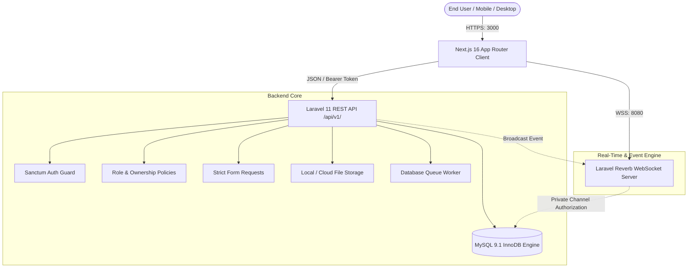

# PlaceX TARGET ARCHITECTURE

## 1. Multi-Tier Architecture Diagram

## 2. Decoupled Category Extension Model
The platform separates core listing fields (searchable, indexable, price, location) from 1-to-1 polymorphic extension records:
- `job_details`: Compensation periods, workplace type, experience level.
- `property_details`: Square footage/marla, bedrooms, amenities JSON.
- `classified_details`: Subcategory, condition, brand, model.
- `vehicle_details`: Make, model, year, transmission, fuel type, mileage.
- `matrimonial_profiles`: Age, education, caste, privacy control, preferences.

