# ENTITY RELATIONSHIPS & SCHEMA DESIGN (PlaceX)

## Architecture Overview
PlaceX implements a hybrid relational model tailored for a high-traffic, multi-category marketplace. Shared metadata and discovery attributes reside on core polymorphic/parent tables, while specialized attributes for the five primary categories are strictly decoupled into 1-to-1 extension tables.

```mermaid
erDiagram
    users ||--o{ user_profiles : "1:1 profile"
    users ||--o{ seller_profiles : "1:1 seller"
    users ||--o{ role_user : "assigned"
    roles ||--o{ role_user : "granted"
    roles ||--o{ permission_role : "contains"
    permissions ||--o{ permission_role : "granted"

    users ||--o{ listings : "publishes (user_id)"
    categories ||--o{ listings : "categorizes (category_id)"
    locations ||--o{ listings : "located_at (location_id)"

    listings ||--o{ listing_images : "has many"
    listings ||--o{ listing_attributes : "flexible key-values"
    listings ||--o{ listing_status_history : "tracks transitions"
    listings ||--o{ listing_views : "telemetry"
    listings ||--o{ listing_favourites : "saved by user"
    listings ||--o{ listing_reports : "reported by user"

    listings ||--o| job_details : "category 1:1"
    listings ||--o| property_details : "category 1:1"
    listings ||--o| classified_details : "category 1:1"
    listings ||--o| vehicle_details : "category 1:1"
    listings ||--o| matrimonial_profiles : "category 1:1"
    matrimonial_profiles ||--o| matrimonial_preferences : "partner criteria"

    users ||--o{ conversations : "initiates"
    conversations ||--o{ conversation_participants : "members (user_id, conv_id)"
    conversations ||--o{ messages : "has messages"
    messages ||--o{ message_attachments : "files/images"

    listings ||--o{ listing_promotions : "featured/boost"
    promotion_plans ||--o{ listing_promotions : "plan type"
    users ||--o{ promotion_entitlements : "admin credits"

    users ||--o{ user_blocks : "blocks"
    listings ||--o{ moderation_cases : "audited"
    users ||--o{ audit_logs : "actions"
```

## Key Entities & Relationship Rules
1. **Core Listing Isolation**: `listings` contains strictly shared fields (`title`, `slug`, `price`, `currency`, `location_id`, `latitude`, `longitude`, `listing_status`, `moderation_status`, timestamps).
2. **Category Specifics**:
   - `job_details`: employment type, salary range, experience level, employer name, workplace type (remote/onsite/hybrid).
   - `property_details`: purpose (sale/rent), property type, area, unit, bedrooms, bathrooms, amenities.
   - `classified_details`: condition (new/used), brand, model, warranty.
   - `vehicle_details`: make, model, variant, year, mileage, transmission, fuel type, engine capacity, body type, assembly.
   - `matrimonial_profiles` & `matrimonial_preferences`: private personal attributes, strict visibility boundaries, education, profession, family background.
3. **Communication Boundaries**:
   - Conversations are distinct rooms linked to an optional `listing_id` and buyer/seller `user_id`.
   - `conversation_participants` enforces unique `(conversation_id, user_id)` pairs to prevent duplicate members.
4. **Location Strategy**:
   - `locations` table stores hierarchically normalized country/state/city.
   - Listings store approximate/public location plus separate latitude/longitude for spatial distance indexing, protecting precise seller addresses.

